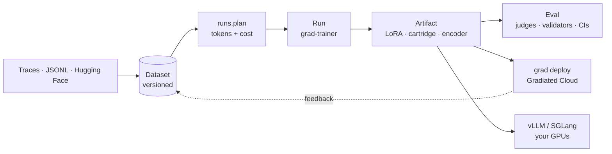

<p align="center">
  <a href="https://gradiated.com/docs/training/">
    <picture>
      <source media="(prefers-color-scheme: dark)" srcset="docs/assets/grad-wordmark-dark.svg">
      <source media="(prefers-color-scheme: light)" srcset="docs/assets/grad-wordmark.svg">
      
    </picture>
  </a>
</p>

<h3 align="center">Turn your production traces into small models that do one job well.</h3>

<p align="center">
  <a href="https://github.com/Gradiated/grad/actions/workflows/ci.yml"></a>
  <a href="LICENSE"></a>
  <a href="https://gradiated.com/docs/training/"></a>
  <a href="#sdks-and-cli"></a>
  <a href="#self-hosting"></a>
</p>

<p align="center">
  <a href="https://gradiated.com/docs/training/"><b>Docs</b></a> ·
  <a href="#quickstart"><b>Quickstart</b></a> ·
  <a href="#what-you-can-train"><b>Recipes</b></a> ·
  <a href="#self-hosting"><b>Self-hosting</b></a> ·
  <a href="#roadmap"><b>Roadmap</b></a>
</p>

---

`grad` trains, evaluates and serves small task-specific models: a router that sends easy requests to a cheap model, an 8B fine-tune that replaces a frontier call, an embedding model tuned to your docs. You bring the traces you already log. `grad` tells you what a run will cost before it starts, scores the result against a baseline with confidence intervals, and ships it with one command.

It is one open-source codebase. The same server runs on your laptop (`grad local up`), in your Kubernetes cluster (Helm), and as [Gradiated Cloud](https://gradiated.com/docs/training/).

## Quickstart

Install the Python SDK and the CLI:

```bash
pip install grad-sdk
cargo install --git https://github.com/Gradiated/grad grad-cli   # the `grad` binary
export GRADIATED_API_KEY=grad_...
```

Train a router on your support traces, deploy it, and route live traffic:

```python
from grad import Grad, Judge
from grad.recipes import RouterRecipe

client = Grad()  # reads GRADIATED_API_KEY

# 1. Push traces: OpenAI chat JSONL, OTel, Langfuse, PostHog, Braintrust or LangSmith exports
dataset = client.datasets.push("support-prod", "./support_traces.jsonl")

# 2. Pick the candidates and a grader, then preview defaults, warnings, tokens and cost for $0
recipe = RouterRecipe(
    models=["qwen/qwen3-8b", "qwen/qwen3-32b"],
    rubric=Judge(model="qwen/qwen3-32b", prompt="Did the reply resolve the customer's issue?"),
)
print(client.runs.plan(dataset=dataset, name="support-router", recipe=recipe))

# 3. Train under a hard spend cap, then deploy
run = client.runs.create(
    dataset=dataset, name="support-router", recipe=recipe, max_cost_usd=20
).wait()
run.deploy()

# 4. Route a request and log the outcome
messages = [{"role": "user", "content": "Where is invoice #9941?"}]
decision = client.route("support-router", messages)
print(decision.model)  # call this model with your own client
decision.record_feedback(score=1.0)
```

The same loop from the CLI. It trains on the scores already in your traces; use a `Judge` from an SDK to grade unscored ones.

```bash
grad login
grad import ./support_traces.jsonl --dataset support-prod
grad train --dataset support-prod --name support-router --recipe router --dry-run
grad train --dataset support-prod --name support-router --recipe router --max-cost-usd 20 --wait
grad deploy support-router@latest
grad route --deployment support-router --prompt "Where is invoice #9941?"
```

<details>
<summary><b>TypeScript, Go and Rust</b></summary>

```ts
import { Grad, recipes } from "@gradiated/grad";

const grad = new Grad();
const dataset = await grad.datasets.create("support-prod");
await dataset.importFile("./support_traces.jsonl").wait();

const params = { dataset, name: "support-router", recipe: recipes.router(), maxCostUsd: 20 };
console.log(await grad.runs.plan(params));
const run = await grad.runs.create(params).wait();
await run.deploy();
```

```go
client := grad.NewClient()
dataset, _ := client.Datasets.Create(ctx, "support-prod")
dataset.ImportFile(ctx, "./support_traces.jsonl").Wait(ctx)

params := grad.RunParams{
	Dataset:    dataset,
	Name:       "support-router",
	Recipe:     grad.RouterRecipe{},
	MaxCostUSD: 20,
}
plan, _ := client.Runs.Plan(ctx, params)
fmt.Println(plan)
run, _ := client.Runs.Create(ctx, params).Wait(ctx)
_, _ = run.Deploy(ctx)
```

```rust
use grad_sdk::{recipes, Client, DeployRequest, ImportFileOptions, RunRequest, WaitOptions};

let client = Client::new();
let wait = WaitOptions::default();
let path = std::path::Path::new("./support_traces.jsonl");
let job = client.datasets().import_file("support-prod", path, &ImportFileOptions::default()).await?;
client.imports().wait(&job.id, &wait).await?;

let req = RunRequest {
    max_cost_usd: Some(20.0),
    ..RunRequest::new("support-prod", "support-router", recipes::router(vec![]))
};
println!("~${:.2}", client.runs().plan(&req).await?.estimated_cost_usd);
let run = client.runs().create(&req).await?;
client.runs().wait(&run.id, &wait).await?;

let deploy = DeployRequest { artifact: "support-router@latest".into(), ..Default::default() };
client.deployments().create(&deploy).await?;
```

</details>

New to it? The [training overview](https://gradiated.com/docs/training/) walks the full loop, and the [router guide](https://gradiated.com/docs/training/recipes/router/) covers the data a router needs.

## What you can train

Six recipes. Each one has calibrated defaults (learning rate, batch size, schedule, split) that `runs.plan` prints before you spend anything.

| Recipe | What you get | Data | Default base |
| --- | --- | --- | --- |
| [`SFTRecipe`](https://gradiated.com/docs/training/recipes/sft/) | A LoRA fine-tune that produces the outputs you show it | Chat records; the last assistant turn is the target | `qwen/qwen3-8b` |
| [`DPORecipe`](https://gradiated.com/docs/training/recipes/dpo/) | A model that prefers your good answers over your bad ones | `prompt` + `chosen` + `rejected` | `qwen/qwen3-8b` |
| [`RouterRecipe`](https://gradiated.com/docs/training/recipes/router/) | Picks the cheapest model per request within a quality budget | Prompts + scores, or a `Judge` to grade them | `qwen/qwen3-0.6b` |
| [`DecisionModelRecipe`](https://gradiated.com/docs/training/recipes/decision-model/) | A calibrated multi-head model for `choice`, `noul` and `score` questions | State + questions + `expected_output` | `gradiated/linden-1` |
| [`CartridgeRecipe`](https://gradiated.com/docs/training/recipes/cartridges/) | A PrefixKV cartridge that stands in for a long, repeated prompt | A static `Context` (text or file) | `qwen/qwen3-8b` |
| [`EmbeddingRecipe`](https://gradiated.com/docs/training/recipes/embeddings/) | An encoder tuned for search over your docs and code | `query` + `positive` (+ `negatives`) | `baai/bge-small-en-v1.5` |

What every run gives you:

- **Datasets from anywhere.** Push records or a `.jsonl`/`.json`/`.parquet` file (trace exports from OpenAI, OTel, Langfuse, PostHog, Braintrust and LangSmith are detected automatically), or pull a Hugging Face dataset server-side with `client.datasets.from_hf(...)`. Datasets are versioned, and every run pins the version it trained on.
- **Cost before compute.** `runs.plan(...)` (`grad train --dry-run`) returns the resolved recipe, data warnings, token count and price. `max_cost_usd` is a hard cap: the run stops and keeps its checkpoint.
- **Real weights.** LLM runs train LoRA adapters (or PrefixKV cartridges). Downloads are SHA-256-verified PEFT directories (`adapter_config.json`, `adapter_model.safetensors`) that load straight into vLLM or SGLang. `SFTRecipe(merge_on_export=True)` exports merged safetensors instead.
- **Checkpoints and resume.** Checkpoints are kept for 30 days (best and final forever); `runs.resume(...)` continues a stopped run, and any checkpoint can be promoted to an artifact.

## Evaluate before you ship

Compare base models and your artifacts on a held-out dataset with the same rubric you train with. Rubrics mix LLM judges and deterministic validators (`JSON`, `NonEmpty`, `ExactMatch`, `Regex`). Reports include a 95% bootstrap confidence interval per model, pass@k, and a paired difference against the baseline.

```python
from grad import Judge, Rubric, validators

ev = client.evals.create(
    models=["qwen/qwen3-8b", "sql-helper@latest"],
    dataset="sql-holdout",
    rubric=Rubric([
        validators.Regex(r"^\s*SELECT", flags="i"),
        Judge(model="qwen/qwen3-32b", prompt="Does the query answer the question?"),
    ]),
    baseline="qwen/qwen3-8b",
).wait()
print(ev.summary_table())
```

`grad eval --models ... --dataset ... --rubric rubric.yaml --wait` does the same from the CLI, and `ev.failures().to_dataset("sql-hard")` turns misses into your next training set. See [Evaluations](https://gradiated.com/docs/training/evaluations/).

## Deploy

On Gradiated Cloud, `run.deploy()` or `grad deploy NAME@VERSION` serves an artifact as `your-org/<name>` behind the OpenAI-compatible API, so your app changes one `model` string. Rolling back is one command: `grad rollback NAME`, or deploy an earlier version.

Anywhere else, download the weights and serve them yourself:

```bash
grad artifacts download sql-helper@latest --output ./sql-helper
vllm serve Qwen/Qwen3-8B --enable-lora --lora-modules sql-helper=./sql-helper
```

See [Deploying](https://gradiated.com/docs/training/deploying/) for SGLang and the Cloud endpoints.

## How it works



- **`grad-server`** ([`server/api`](server/api)) is the control plane: datasets, runs, checkpoints, artifacts, evals and keys. It needs PostgreSQL and S3-compatible storage, nothing else. Every route is defined in one OpenAPI 3.1 contract, [`spec/openapi.yaml`](spec/openapi.yaml).
- **`grad-trainer`** ([`server/trainer`](server/trainer)) is a worker that claims jobs over HTTP, trains the recipe, uploads checkpoints and bundles, and drains cleanly on SIGTERM. Add workers to add capacity.
- **Four SDKs and a CLI** are thin layers over transports generated from the spec, so they cannot drift from the server.

Cloud adds three adapters on top of the same code (auth, per-token billing, hosted deploy); it never forks it. Details in [ARCHITECTURE.md](docs/ARCHITECTURE.md).

## Self-hosting

Self-hosted `grad` needs only Postgres and S3 (or a local directory for `grad local up`). Start everything locally with one command:

```bash
grad local up                 # Postgres, grad-server on 127.0.0.1:8787, a CPU trainer
grad local up --gpu           # add the CUDA trainer (NVIDIA Container Toolkit)
export GRADIATED_PROFILE=local
```

The CPU trainer is for trying the workflow on small data; real training uses `grad local up --gpu` or GPU nodes.

The first run generates an admin key, a trainer key and the workspace-secrets key and saves them to a `local` CLI profile. `grad local status`, `grad local logs` and `grad local down` manage the stack.

For production, create the `grad` Secret described in [docs/SELF_HOSTING.md](docs/SELF_HOSTING.md) (database URL, admin key hash, trainer key), then install the Helm chart against your own Postgres and S3 bucket. It runs migrations in a Job, two API replicas, a GPU `train` worker pool and a CPU `import` worker pool, with optional KEDA scale-to-zero and NetworkPolicies:

```bash
helm upgrade --install grad server/helm/grad --namespace grad \
  --set storage.s3Bucket=my-grad-artifacts \
  --set evals.inferenceBaseUrl=https://vllm.internal.example.com/v1 \
  --set keda.enabled=true
```

Datasets, training, evals (against your own OpenAI-compatible endpoint) and artifact downloads all work self-hosted; hosted `deploy` and `/v1/route` are Gradiated Cloud features. Server configuration and retention are in [docs/SELF_HOSTING.md](docs/SELF_HOSTING.md) and the [self-hosting guide](https://gradiated.com/docs/training/self-hosting/).

## SDKs and CLI

| | Install | Source |
| --- | --- | --- |
| Python | `pip install grad-sdk` | [`sdks/python`](sdks/python) |
| TypeScript | `npm install @gradiated/grad` | [`sdks/typescript`](sdks/typescript) |
| Go | `go get github.com/Gradiated/grad/sdks/go` | [`sdks/go`](sdks/go) |
| Rust | `cargo add grad-sdk` | [`sdks/rust`](sdks/rust) |
| CLI | `cargo install --git https://github.com/Gradiated/grad grad-cli` | [`cli`](cli) |

All four SDKs cover the same surface: datasets, runs, checkpoints, artifacts, evals, deployments, routing and feedback. They read `GRADIATED_API_KEY` and `GRADIATED_BASE_URL` (point it at `http://127.0.0.1:8787` for a local stack), and verify every artifact download against its SHA-256.

The CLI is built for scripts and coding agents: `--json` on any command prints one machine-readable envelope on stdout, and `grad --help` lists every command, the configuration precedence and the exit codes.

<details>
<summary><b>Repository layout</b></summary>

```text
spec/openapi.yaml        OpenAPI 3.1 contract, emitted from server/api
server/api/              grad-server: TypeScript + Hono, Postgres + S3
server/trainer/          grad-trainer: Python recipes, trace connectors, bundle export
server/helm/grad/        Helm chart (KEDA scale-to-zero, air-gapped overrides)
server/docker-compose.yml  Source-build stack for `grad local up --build`
cli/                     Rust `grad` CLI (embeds the compose file for `grad local up`)
sdks/python/             grad-sdk
sdks/typescript/         @gradiated/grad
sdks/go/                 github.com/Gradiated/grad/sdks/go
sdks/rust/               grad-sdk crate
scripts/generate-sdks.mjs  OpenAPI -> SDK transport codegen (`--check` in CI)
scripts/check-docs-snippets.py  Runs the docs' Python and CLI blocks against a live stack
tests/harness/           Live stack (Postgres, S3, fake Cloud) the SDK and CLI suites run against
tests/fixtures/wire/     Wire fixtures every SDK replays, including the parity fixture
```

</details>

## Development

Toolchain versions are pinned in [`mise.toml`](mise.toml). Run `mise install`, then:

```bash
pnpm -C server/api install --frozen-lockfile
pnpm -C server/api check                     # API typecheck + tests
pnpm -C server/api openapi:generate          # re-emit spec/openapi.yaml after API changes
node scripts/generate-sdks.mjs               # regenerate the four SDK transports from the spec

pip install -e "sdks/python[dev]" && python3 -m unittest discover -s sdks/python/tests
pnpm -C sdks/typescript install --frozen-lockfile && pnpm -C sdks/typescript check
(cd sdks/go && go test ./...)
cargo test --workspace                       # Rust SDK + CLI

grad local up --build                        # run the stack from this checkout
```

To check the code blocks of the public training docs (a checkout of the website repo), build the CLI and run:

```bash
python3 scripts/check-docs-snippets.py --docs ../workspace/product/website/src/docs/training          # reference worker
GRAD_TRAINER_PYTHON=/path/to/torch/python python3 scripts/check-docs-snippets.py --docs ... --cloud   # deploy, route, embed
```

It prints PASS, FAIL or SKIP (with the reason) for every block. Blocks that need a GPU, Hugging Face, the inference gateway or a cluster are skipped; the skip list and fixtures are at the top of the script.

CI ([`.github/workflows/ci.yml`](.github/workflows/ci.yml)) runs all of this, plus the server on real Postgres and S3, every recipe on tiny models on CPU, the codegen drift check, and every SDK and the CLI against a live stack. Pull requests are welcome: see [CONTRIBUTING.md](CONTRIBUTING.md), and please keep the self-hosted path free of Cloud-only dependencies.

## Roadmap

v0 ships the six recipes above. Next, in rough order:

- [ ] `GRPORecipe` for multi-turn agents, with environments served from your machine by `grad env serve`
- [ ] `DistillRecipe` (teacher to student) and `RewardModelRecipe`
- [ ] Chained runs (`run.then(...)`, e.g. SFT then DPO) and an async Python client
- [ ] Interactive `Trainer` API: `forward_backward()`, `optim_step()`, custom losses
- [ ] Canary and shadow deploys with automatic rollback on a quality drop
- [ ] Managed sandboxes for untrusted environments and Python scorers
- [ ] Multimodal records and larger MoE base models

## License

MIT. See [LICENSE](LICENSE).
